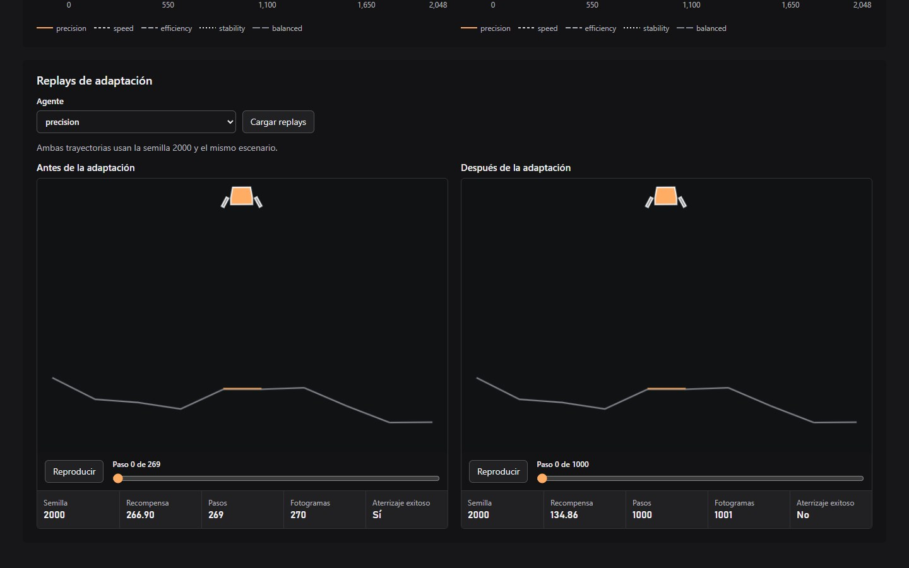

# Rocket RL Lab

Proyecto educativo de aprendizaje por refuerzo para estudiar cómo el
diseño de recompensas y los cambios de escenario afectan el aterrizaje
de agentes PPO en LunarLander-v3.

## Demo pública

[Explorar Rocket RL Lab en Vercel](https://rocket-rl-lab.vercel.app/)

La demo de solo lectura muestra un experimento real en el que cinco agentes
PPO se evaluaron con las mismas 30 semillas antes y después de 2,048 pasos
adicionales de entrenamiento. La plataforma tenía la mitad de su ancho
habitual.



| Agente | Éxito antes | Éxito después |
| --- | ---: | ---: |
| Precision | 63.3% | 53.3% |
| Speed | 30.0% | 26.7% |
| Efficiency | 26.7% | 50.0% |
| Stability | 73.3% | 73.3% |
| Balanced | 23.3% | 30.0% |

Ningún agente alcanzó el criterio de 90% de éxito en dos evaluaciones
consecutivas dentro del presupuesto. Cada par de replays muestra una
trayectoria antes y otra después, con la misma semilla y el mismo escenario.

Vercel compila `frontend` con `npm run build`, publica `dist` y selecciona la
demo con `VITE_STATIC_DEMO=true`. Las evaluaciones y trayectorias se sirven
como JSON estático. El entrenamiento, FastAPI y el worker se ejecutan
localmente en Windows.

## Entorno de desarrollo

- Windows con PowerShell.
- Python 3.13 de 64 bits.
- Node.js 24 y npm.
- Entrenamiento local con CPU.

## Preparar el proyecto

Ejecutar desde la raíz del repositorio.

### Backend

Crear el entorno e instalar primero PyTorch desde su repositorio de CPU:

```powershell
py -3.13 -m venv backend\.venv
& .\backend\.venv\Scripts\python.exe -m pip install "torch==2.14.1+cpu" --index-url https://download.pytorch.org/whl/cpu
& .\backend\.venv\Scripts\python.exe -m pip install -r .\backend\requirements.txt
& .\backend\.venv\Scripts\python.exe -m pip check
```

### Frontend

Instalar las versiones registradas en package-lock.json y compilar:

```powershell
npm --prefix frontend ci
npm --prefix frontend run build
```

## Estado actual

- **Laboratorio neutral.** Entrenamiento y evaluación por consola.
  La web permite consultar métricas y reproducir trayectorias grabadas
  del simulador.
- **Cinco especialidades.** Precision, Speed, Efficiency, Stability y
  Balanced parten de checkpoints preentrenados en condiciones neutras
  con el mismo presupuesto de entrenamiento.
- **Desafío de adaptación.** La interfaz permite crear experimentos con
  presets y ajustar gravedad, ancho de plataforma, límite de pasos y
  combustible. Cada agente parte de su checkpoint y recibe un presupuesto
  de entrenamiento adicional.
- **Seguimiento y comparación.** Un worker procesa los trabajos en
  secuencia. La interfaz muestra progreso por SSE, curvas de evaluación
  y una tabla con los pasos hasta el criterio cuando se confirma.
- **Persistencia.** SQLite conserva los trabajos y sus eventos. El UUID
  del experimento permite recuperar la tabla y las curvas al volver a
  abrir la interfaz.

El [registro de experimentos](docs/experiment-results.md) recoge las
evaluaciones de los modelos y sus limitaciones.

## Ejecutar en desarrollo

Arranca la API con los comandos de [Crear y cancelar por HTTP](#crear-y-cancelar-por-http).
Esa sección incluye la preparación de la credencial local para crear experimentos.

En otra terminal de PowerShell, desde `frontend`, inicia Vite.

```powershell
npm run dev
```

Abre [Rocket RL Lab](http://127.0.0.1:5173). El proxy de Vite dirige
las solicitudes de `/api` a FastAPI en el puerto 8000.

Para procesar experimentos de adaptación, inicia el [worker](#worker)
en una tercera terminal.

### Usar el desafío de adaptación

1. Abre **Desafío de adaptación** y pulsa **Cargar agentes** para
   comprobar que estén disponibles los cinco checkpoints.
2. Desde `backend`, en una terminal libre, copia la credencial local
   al portapapeles.

   ```powershell
   Set-Clipboard -Value (
       (Get-Content -LiteralPath .\.env.operator-token -Raw).Trim()
   )
   ```

   Pégala con `Ctrl+V` en **Credencial de operador**.
3. Elige el escenario y el presupuesto. Para una primera ejecución,
   selecciona **Solo evaluación (0 pasos adicionales)** y pulsa
   **Crear experimento**.
4. Guarda el UUID que aparece junto a **Experimento**. Para recuperar
   la tabla y las curvas, introdúcelo en **Consultar experimento**.
   La consulta está disponible sin credencial.

## Entrenamiento por consola

Desde la carpeta backend, utilizando un nombre de checkpoint nuevo:

```powershell
& .\.venv\Scripts\python.exe -m app.rl.train --checkpoint checkpoints/mi_experimento.zip --timesteps 10240 --time-penalty 0.05
```

Los pasos deben ser positivos y múltiplos de 2048.

Con `--time-penalty 0`, `--hover-bonus 0`, `--progress-weight 0`,
`--horizontal-progress-weight 0`, `--fuel-penalty 0`
y `--stability-penalty 0` se conserva la recompensa original.
- `--time-penalty` resta un costo en cada paso.
- `--hover-bonus` agrega un premio en cada paso que cumple la condición de estabilidad.
- `--progress-weight` pondera el cambio de distancia al objetivo, calculado con las coordenadas normalizadas de la observación.
- `--horizontal-progress-weight` pondera la reducción del error horizontal respecto al centro: `abs(x anterior) - abs(x actual)`. Acercarse suma, alejarse resta y mantener el mismo error aporta cero.
- `--fuel-penalty` multiplica un costo adicional por uso de motores: `0` sin propulsión, `0.03` para un lateral y `0.30` para el principal. Estos costos relativos no representan un tanque de combustible finito.
- `--stability-penalty` multiplica un costo por paso calculado como la suma de cuadrados de las velocidades horizontal y vertical, la inclinación y el giro de la observación (`observation[2:6]`). Las velocidades utilizan las escalas de Gymnasium.
`--agent` selecciona un perfil inicial: `precision`, `speed`,
`efficiency`, `stability` o `balanced`. Sus pesos se definen en
`backend/app/rl/agent_profiles.py`.

Los parámetros de recompensa proporcionados explícitamente reemplazan
los valores del perfil, incluso cuando su valor es cero.
Sin `--agent`, los pesos omitidos se resuelven a cero.

Cada experimento registra el perfil seleccionado en `agent_profile`
y los pesos efectivos en `reward`. Los perfiles son configuraciones
exploratorias; sus nombres no demuestran comportamientos aprendidos.

Cada ensayo guarda configuración y métricas en
backend/experiments/training/<id>.
Las recompensas de entrenamiento incluyen el shaping.

Para evaluar el modelo con la recompensa original:

```powershell
& .\.venv\Scripts\python.exe -m app.rl.evaluate --checkpoint checkpoints/mi_experimento.zip
```
## Evaluación con escenario configurable

Desde la carpeta backend, usando un checkpoint existente:

```powershell
& .\.venv\Scripts\python.exe -m app.rl.evaluate `
    --checkpoint checkpoints/stability.zip `
    --gravity -5 `
    --max-episode-steps 5
```

Este ejemplo verifica el corte del episodio a los cinco pasos;
no ofrece tiempo suficiente para aterrizar.

- `--gravity` acepta valores finitos mayores que -12 y menores que 0.
- `--max-episode-steps` acepta enteros positivos.
- Sin estos parámetros se utilizan gravedad -10 y límite de 1000 pasos.
- La evaluación utiliza la recompensa original del escenario elegido,
  sin agregar reward shaping ni entrenar el modelo.
- Cada nuevo resultado guarda su configuración en `scenario`.
  La web muestra esos valores y señala cuando un registro antiguo
  no incluye la configuración.

### Combustible finito

El evaluador acepta `--fuel-budget` con una capacidad finita,
mayor o igual a cero. Omitirlo conserva combustible ilimitado.

El consumo por paso utiliza unidades relativas:
0 sin propulsión, 0.03 para un lateral y 0.30 para el principal.
No representa litros ni una magnitud física calibrada.

Si no alcanza para la acción solicitada, se ejecuta ese paso
sin propulsión y sin consumir combustible. No hay encendidos
parciales. El vuelo continúa hasta su final físico o límite
temporal; quedarse sin combustible no termina el episodio.
Cada reset recarga el tanque.

Ejemplo desde backend, con un checkpoint existente:

```powershell
& .\.venv\Scripts\python.exe -m app.rl.evaluate `
    --checkpoint checkpoints/stability.zip `
    --fuel-budget 0 `
    --max-episode-steps 5
```

El consumo registrado y la penalización adicional por combustible
utilizan las acciones efectivamente ejecutadas. `--fuel-penalty`
modifica la recompensa; `--fuel-budget` limita la propulsión.

La web distingue capacidad numérica, combustible ilimitado
y capacidad no registrada en evaluaciones anteriores.

### Plataforma variable

`--platform-width-scale` acepta valores finitos entre 0.25 y 2.0,
incluidos ambos extremos. Su valor predeterminado es 1.0.

La escala cambia el ancho conservando el centro y las alturas.
Se reconstruyen los segmentos de colisión y el terreno dibujado.
Cada reset aplica la escala sobre el terreno recién generado;
la escala 1.0 conserva el entorno original.

Ejemplo desde backend, con un checkpoint existente:

```powershell
& .\.venv\Scripts\python.exe -m app.rl.evaluate `
    --checkpoint checkpoints/stability.zip `
    --platform-width-scale 0.5
```
La configuración se guarda en `scenario.platform_width_scale`
y se muestra junto a los resultados de evaluación.

Se conservan las ocho observaciones originales. Los parámetros
del escenario no se incorporan directamente a la observación.

## Adaptación por consola

Desde backend, con el checkpoint de la especialidad disponible:

```powershell
& .\.venv\Scripts\python.exe -m app.rl.adapt `
    --agent stability `
    --config configs/narrow_pad.json
```

La configuración de ejemplo permite 20.480 pasos adicionales,
en bloques de 10.240, sobre una plataforma con la mitad del ancho.

Se evalúa antes de entrenar y después de cada bloque, usando
30 semillas fijas. El criterio exige al menos 90% de éxito
en dos evaluaciones consecutivas. Si supera el control inicial,
se confirma con otras 30 semillas antes de marcar `already_adapted`.

Cada ejecución guarda configuración, checkpoints, evaluaciones
y resultado en `backend/experiments/adaptations/<id>/<agente>/`.

Los estados finales son `already_adapted`, `adapted` y
`budget_reached`. Agotar el presupuesto no implica alcanzar
el criterio. El checkpoint original se conserva.

## Cola persistente de adaptación

La cola utiliza SQLite, incluido en Python. Para inicializarla,
ejecuta desde backend:

```powershell
& .\.venv\Scripts\python.exe -m app.storage.schema
```

La base se guarda en `backend/experiments/rocket_rl.sqlite3`,
con esquema versión 1 y modo WAL. Repetir la inicialización
conserva los datos existentes.

Cada experimento crea cinco trabajos, uno por especialidad.
Solo se permite un experimento pendiente o activo y un trabajo
activo a la vez dentro de la cola.

Se guardan eventos y progreso, conservando la última evaluación
completada mientras se realiza la siguiente.

La cancelación detiene inmediatamente los trabajos pendientes.
El trabajo activo debe confirmar su detención desde el worker.

El comando `app.rl.adapt` ejecuta una sesión directamente
y no utiliza esta cola.

### Consulta HTTP

Con la API iniciada, un experimento existente se consulta mediante
`GET /api/adaptation/experiments/{experiment_id}`.

La respuesta incluye configuración, solicitud de cancelación,
cinco trabajos y el identificador del último evento.
Cada trabajo contiene estado, fechas y progreso disponible.

El progreso conserva la última evaluación completada.
Antes de disponer de mediciones, el progreso o su evaluación
pueden ser `null`.

La consulta utiliza una misma vista de SQLite para obtener
el experimento, sus trabajos y el último evento.
Los errores internos se registran en el servidor y se devuelven
con un mensaje público breve.

La API inicializa el esquema al arrancar.
`GET /api/adaptation/experiments/{experiment_id}/events` transmite los
eventos mediante SSE. La interfaz recupera el historial de evaluaciones
y aplica las actualizaciones en vivo. Cuando todos los trabajos terminan,
el servidor envía el evento `end` y la interfaz cierra la conexión.

### Crear y cancelar por HTTP

Las siguientes rutas requieren `Authorization: Bearer <clave>`:

- `POST /api/adaptation/experiments`: crea cinco trabajos
  y devuelve su estado con HTTP 202.
- `POST /api/adaptation/experiments/{experiment_id}/cancel`:
  solicita la cancelación y devuelve el estado con HTTP 202.

La clave del servidor se configura mediante `ROCKET_OPERATOR_TOKEN`
y debe tener al menos 32 caracteres. Una configuración ausente
o demasiado corta devuelve 503; credenciales ausentes o incorrectas
devuelven 401.

Para generar una clave local y arrancar la API, desde backend:

```powershell
if (-not (Test-Path -LiteralPath .\.env.operator-token)) {
    & .\.venv\Scripts\python.exe -c "import secrets; print(secrets.token_urlsafe(32))" |
        Set-Content -LiteralPath .\.env.operator-token -Encoding ascii
}

$env:ROCKET_OPERATOR_TOKEN = (
    Get-Content -LiteralPath .\.env.operator-token -Raw
).Trim()

& .\.venv\Scripts\python.exe -m uvicorn app.main:app --reload --host 127.0.0.1 --port 8000
```

El archivo `.env.operator-token` está excluido de Git.
Su contenido se carga en la variable de entorno al iniciar el servidor.

La creación acepta la configuración del escenario y del entrenamiento.
Por HTTP, el presupuesto adicional máximo es de 102.400 pasos por agente,
el bloque máximo es de 10.240 y el episodio admite hasta 2.000 pasos.
El presupuesto y el bloque deben ser múltiplos de 2048;
el presupuesto puede ser cero y el bloque debe ser positivo.

Una configuración inválida devuelve 422. Si ya existe un experimento
pendiente o activo, la creación devuelve 409.

### Worker

Desde backend, ejecuta en una terminal independiente:

```powershell
& .\.venv\Scripts\python.exe -m app.workers.runner
```

El worker inicializa SQLite, revisa el trabajo que pudiera haber
quedado activo y procesa los trabajos pendientes uno por uno.
Un bloqueo nativo de Windows impide arrancar dos workers
sobre el mismo almacenamiento.

El progreso y los eventos se guardan en SQLite.
La cancelación del trabajo activo se comprueba entre bloques
de entrenamiento y evaluaciones.

Ctrl+C solicita detener el worker en el siguiente punto seguro.
Los trabajos pendientes permanecen en la cola.

Después de una caída, un resultado final válido se recupera
tras comprobar el hash de su checkpoint. Si no existe resultado
final, el trabajo se marca como interrumpido o cancelado.
Los archivos guardados se conservan; no se reanuda automáticamente
una sesión incompleta.

## Archivos generados

Los entornos, dependencias, compilaciones, secretos, checkpoints y
resultados de experimentos se excluyen mediante .gitignore.

`frontend/public/demo/` contiene la exportación seleccionada para la demo pública.